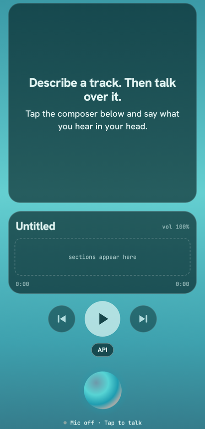
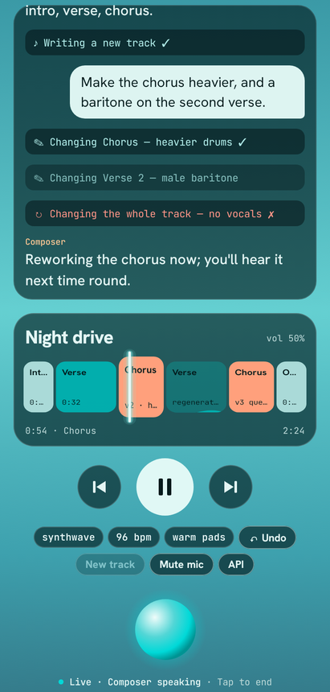
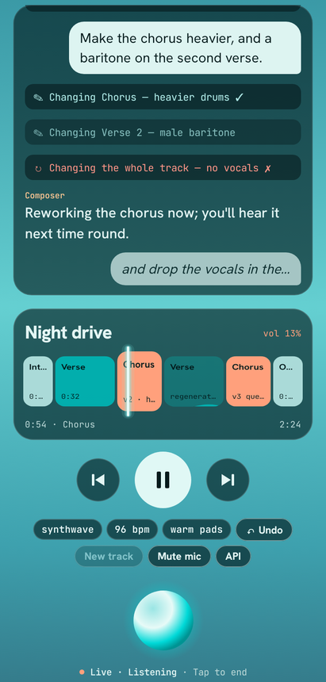
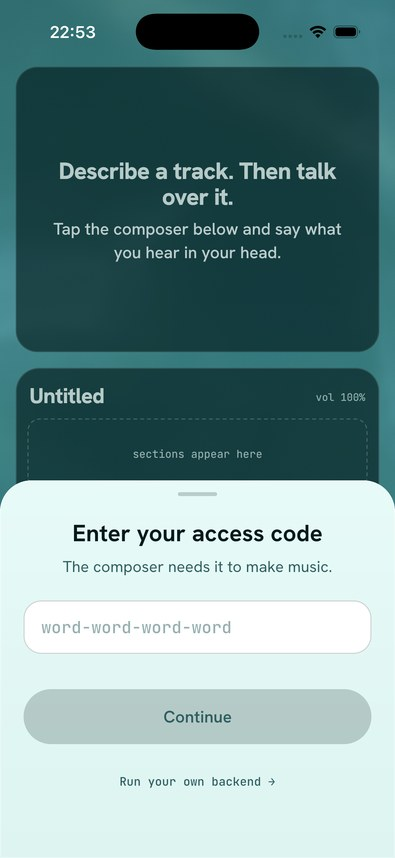

# Dolphin Music 🐬🎹

A voice-first music producer for Android and iOS, built on ElevenLabs Agents and the Music API. Describe a mood by
voice and the composer writes a looping track. Change it by talking over it ("make the chorus heavier", "drop the
vocals"): only the edited section is regenerated and swapped in while the music keeps playing.

## What it does

- **Talk to compose.** Say what you want; the assistant asks a couple of questions and generates the track.
- **Live edits per section.** The track loops while you change one section at a time, with no gap or click.
- **Undo.** Bring back the previous version of a section by tapping Undo or saying "undo that".
- **Tap to jump.** Tap a section label to play from there; seek and play/pause are available at any time.
- **Music ducks while you talk,** and comes back when the speech ends.
- **Picks up where you left off.** The last track and its history are restored on the next start.
- **Android and iOS,** one shared screen.

<p>
  
  
  
  
</p>

## Run your own

The app talks to ElevenLabs through a small Supabase proxy. The build points at the author's proxy; it asks for an
access code on first start, which the author hands out. To use your own ElevenLabs account instead, deploy the proxy
with [`docs/self-hosting.md`](docs/self-hosting.md): it walks through every step and can be handed to a coding agent as is.

## How it is built

Kotlin Multiplatform with Compose Multiplatform: one UI for Android and iOS.

| Module | Role |
|---|---|
| `core/*` | model, dsp, common, domain, codec, database, data, playback, agent, designsystem, testing |
| `feature/producer` | the producer screen |
| `feature/access` | the access code sheet |
| `composeApp` | shared app entry |
| `androidApp`, `iosApp` | platform apps (iOS project is generated by XcodeGen) |
| `supabase/functions` | Deno proxy to ElevenLabs |

Targets: Android, iOS (device and simulator).

```bash
./gradlew verify                              # format, detekt, lint, tests, screenshots
./gradlew iosSimulatorArm64Test               # shared tests on the iOS simulator
./gradlew :androidApp:installDebug            # build and install on a device
./gradlew :androidApp:recordRoborazziDebug    # re-record screenshot goldens
deno test supabase/functions                  # proxy tests
```

iOS: see [`iosApp/README.md`](iosApp/README.md) (`xcodegen generate`, then `xcodebuild` or Xcode).

Setup: only `sdk.dir` in `local.properties` (git-ignored). Optional there: `PROXY_BASE_URL` for your own proxy and,
for debug builds, `ACCESS_CODE`. The proxy's secrets are listed in [`supabase/README.md`](supabase/README.md).

Everything else, including stack, dependency rules, pipelines and delivery, is in
[`docs/architecture.md`](docs/architecture.md); working rules are in [`CLAUDE.md`](CLAUDE.md).
